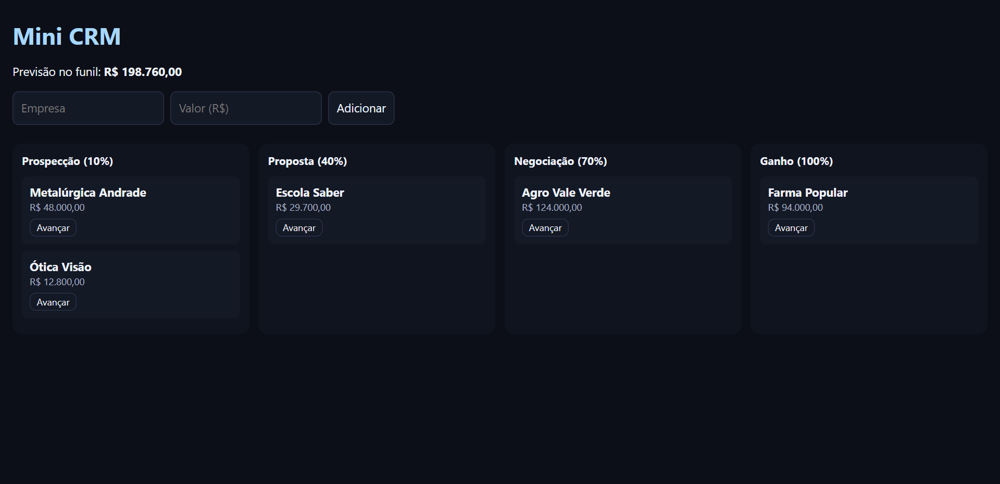

# Mini CRM em Kanban

Funil de vendas visual, em que cada negócio avança por etapas e a previsão de receita se atualiza sozinha.

  

**Demonstração:** https://luizrenatodc.github.io/mini-crm-kanban/

## Veja funcionando



*Funil com negócios fictícios e previsão ponderada.*

## O problema

Times comerciais pequenos controlam oportunidades em planilhas e não enxergam quanto realmente deve entrar. Somar o valor de todas as propostas engana, porque cada etapa tem uma chance diferente de fechar.

## O que ele faz

- Cadastra negócios com empresa e valor.
- Move os cartões entre etapas, arrastando ou pelo botão Avançar.
- Calcula a previsão ponderada pela chance de cada etapa.
- Mantém os dados no navegador entre uma visita e outra.

## Como funciona

| Etapa | Chance |
| --- | --- |
| Prospecção | 10% |
| Proposta | 40% |
| Negociação | 70% |
| Ganho | 100% |

```text
previsão = soma de (valor do negócio × chance da etapa)
```

## Decisões técnicas

| Decisão | Motivo |
| --- | --- |
| Regras em `funil.js`, sem DOM | A lógica é testada sem navegador. |
| `mover` devolve uma nova lista | Evita efeito colateral e simplifica a tela. |
| Botão além do arrastar | Arrastar não funciona bem em tela de toque. |
| `textContent` em vez de `innerHTML` | O texto digitado pelo usuário nunca vira HTML. |

## Como rodar

```bash
npm test
npx serve .
```

## Próximos passos

- Backend com contas de usuário e equipe.
- Histórico de atividades por negócio.
- Chances calculadas a partir do histórico real de fechamento.

## Sobre este projeto

Projeto de demonstração, com dados e empresas fictícios, criado para mostrar a abordagem técnica de forma simples.

## Autor

**Luiz Renato Carvalho**, Engenheiro de Software e IA · [luizrenato.dev](https://www.luizrenato.dev) · [LinkedIn](https://linkedin.com/in/luizrenatodc)
